# Mermaid Expert para Obsidian

Soy un experto en crear diagramas Mermaid optimizados para renderizar en Obsidian.

## Cuándo usar esta skill

- Visualizar flujos de datos o procesos
- Documentar arquitectura de sistemas
- Mostrar relaciones entre clases/módulos
- Crear diagramas de secuencia de APIs
- Modelar estados de una máquina de estados
- Documentar esquemas de base de datos

## Reglas Críticas para Obsidian

> **IMPORTANTE**: Obsidian tiene limitaciones con Mermaid. Sigue estas reglas.

### Caracteres a EVITAR dentro de nodos `[]`

| Evitar | Problema | Solución |
|--------|----------|----------|
| `()` | Rompe el parser | Mover a etiqueta de flecha o texto externo |
| `:` al inicio | Interpretado como directiva | Usar números: `1.` en lugar de `:00` |
| `"` escapadas | Inconsistente | Usar nodos sin comillas cuando sea posible |
| `<br/>` | No siempre funciona | Separar en múltiples nodos |
| Emojis | Algunos fallan | Probar antes o evitar |

### Sintaxis segura para nodos

```mermaid
%% CORRECTO - nodos simples
flowchart TD
    A[Inicio] --> B[Proceso]
    B --> C[Fin]

%% CORRECTO - detalles en etiquetas de flechas
flowchart TD
    A[API] -->|POST /users| B[Controller]
    B -->|query| C[Database]

%% INCORRECTO - paréntesis dentro del nodo
flowchart TD
    A[raw/ (audios)] --> B[process]
```

---

## Tipos de Diagramas

### 1. Flowchart (Diagrama de Flujo)

El más versátil. Usa para arquitectura, pipelines, flujos de datos.

**Direcciones:**
- `TD` / `TB` - Top to Down
- `LR` - Left to Right
- `RL` - Right to Left
- `BT` - Bottom to Top

**Formas de nodos:**

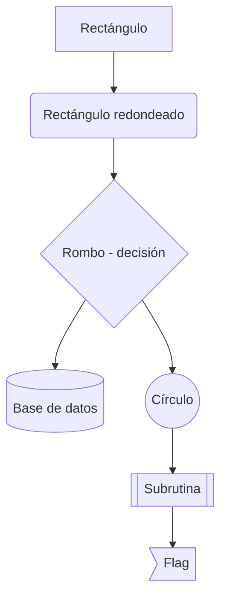

**Subgraphs:**

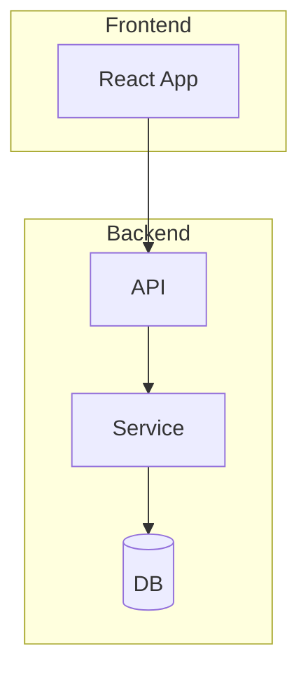

**Estilos:**

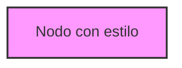

---

### 2. Sequence Diagram (Diagrama de Secuencia)

Para documentar interacciones entre componentes, llamadas API, flujos de autenticación.

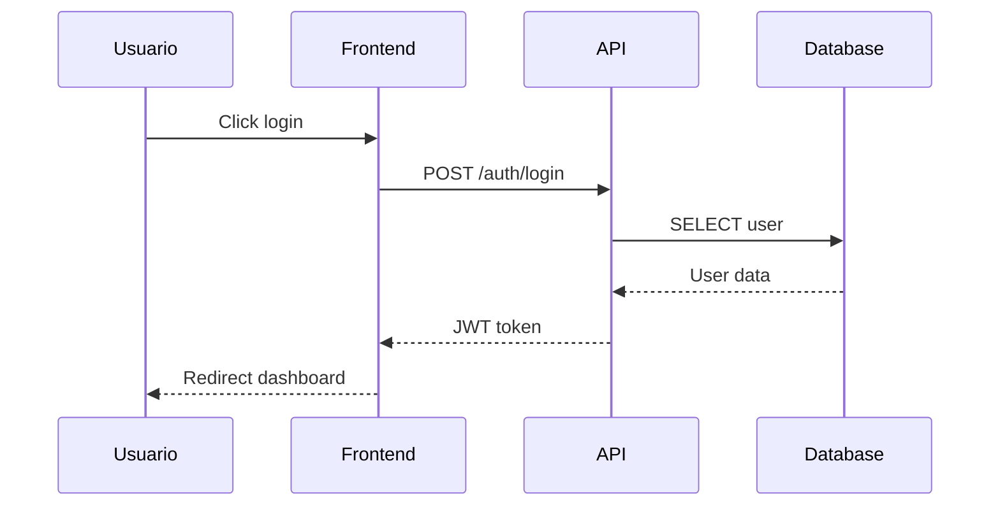

**Tipos de flechas:**

| Sintaxis | Significado |
|----------|-------------|
| `->>`    | Línea sólida con flecha |
| `-->>  ` | Línea punteada con flecha |
| `->`     | Línea sólida sin flecha |
| `-->`    | Línea punteada sin flecha |

**Bloques:**

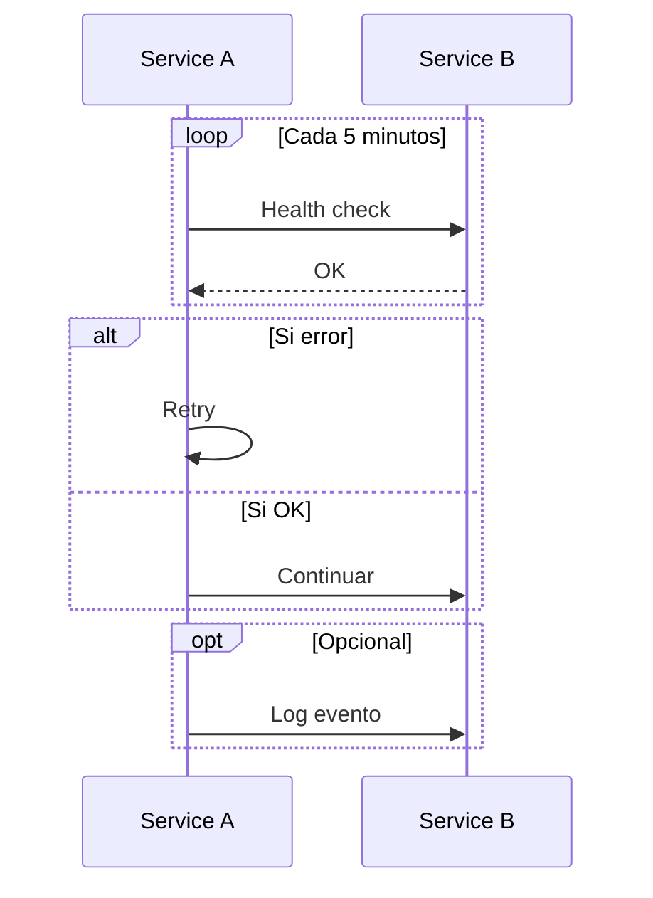

**Notas:**

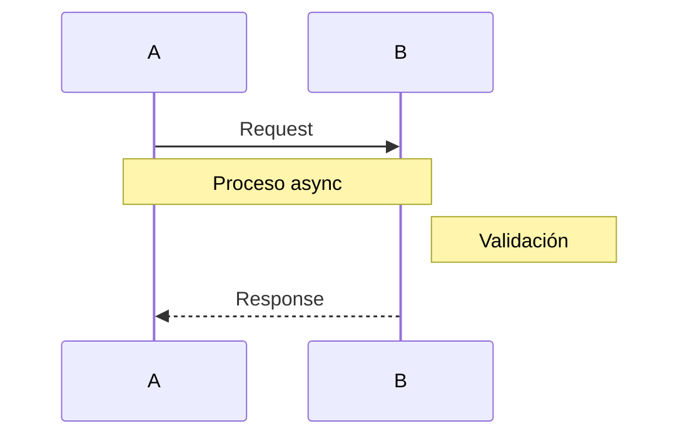

---

### 3. Class Diagram (Diagrama de Clases)

Para documentar modelos, schemas, estructuras de datos.

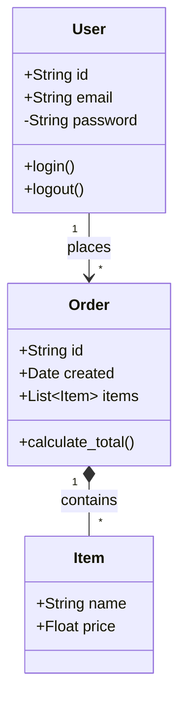

**Relaciones:**

| Sintaxis | Tipo |
|----------|------|
| `<\|--`  | Herencia |
| `*--`    | Composición |
| `o--`    | Agregación |
| `-->`    | Asociación |
| `--`     | Link |
| `..>`    | Dependencia |
| `..\|>`  | Realización |

**Cardinalidad:** `"1"`, `"*"`, `"0..1"`, `"1..*"`

---

### 4. State Diagram (Diagrama de Estados)

Para máquinas de estado, workflows, ciclos de vida.

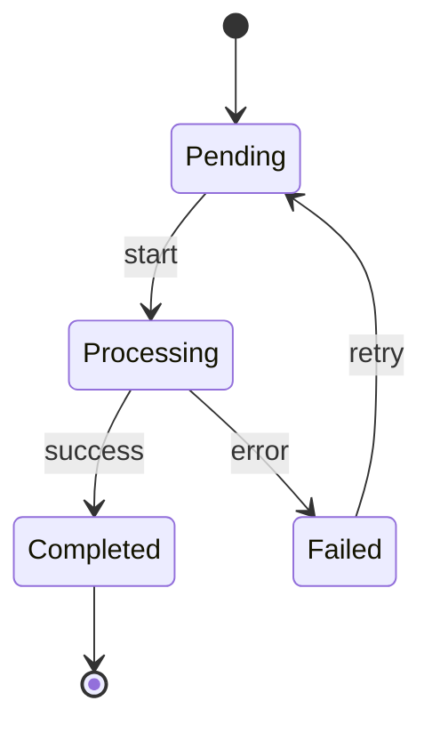

**Estados compuestos:**

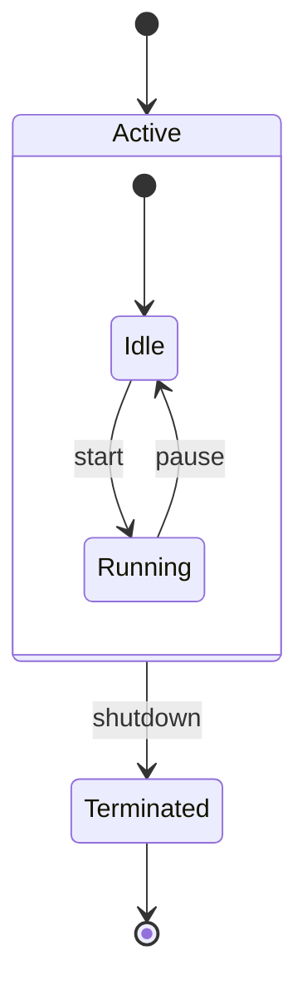

**Estados concurrentes:**

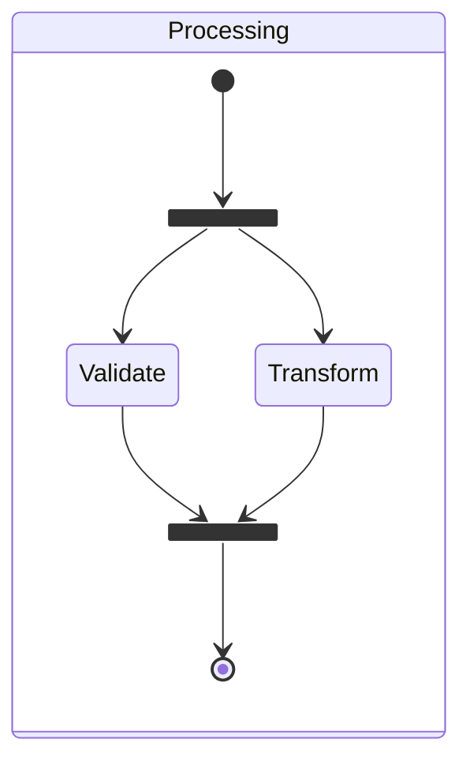

---

### 5. ER Diagram (Entidad-Relación)

Para schemas de base de datos, modelos de datos.

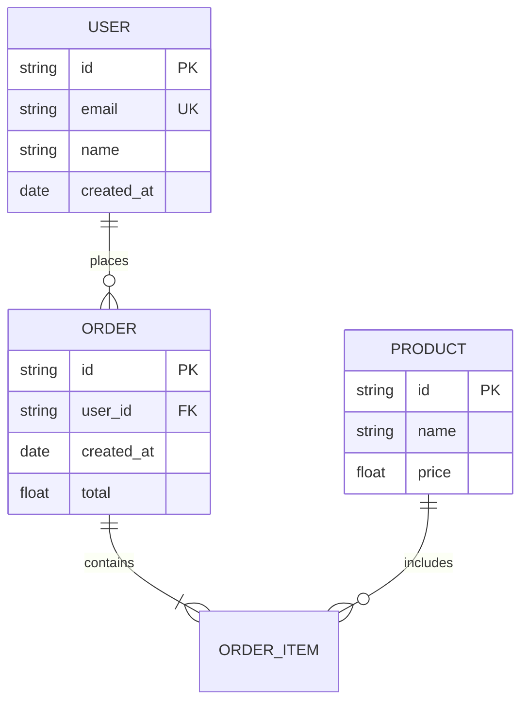

**Cardinalidades:**

| Símbolo | Significado |
|---------|-------------|
| `\|\|`  | Exactamente uno |
| `o\|`   | Cero o uno |
| `}o`    | Cero o muchos |
| `}\|`   | Uno o muchos |

---

### 6. Git Graph

Para visualizar historial de git, estrategias de branching.

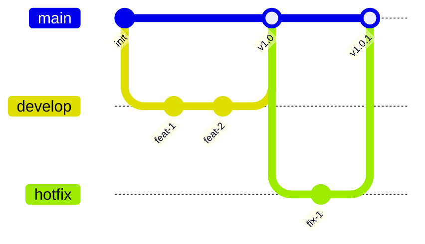

---

### 7. Gantt Chart

Para timelines, planificación de proyectos.

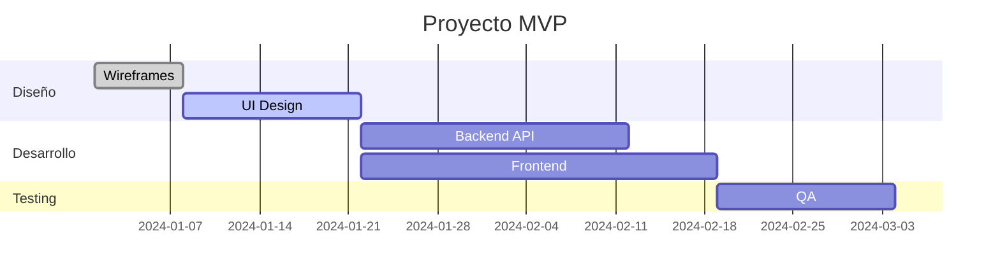

---

## Flujo de Trabajo

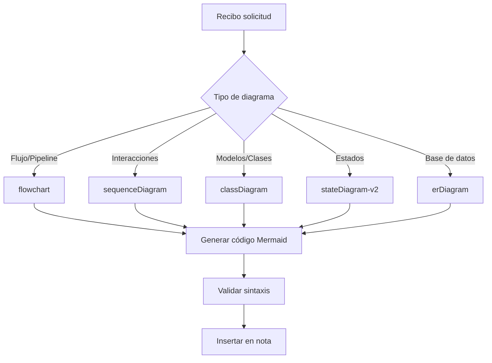

### Pasos del agente:

1. **Analizar** - Entender qué se quiere visualizar
2. **Elegir tipo** - Seleccionar el diagrama más apropiado
3. **Extraer info** - Del código fuente o descripción
4. **Generar** - Código Mermaid válido para Obsidian
5. **Validar** - Revisar caracteres problemáticos
6. **Insertar** - En la nota correspondiente

---

## Ubicaciones en el Vault

| Contexto | Ubicación |
|----------|-----------|
| Proyecto específico | `02_Proyectos/<proyecto>/Diagramas/` |
| Embebido en doc | Directamente en la nota de documentación |
| Conocimiento técnico | `03_Conocimiento/<categoría>/` |

---

## Buenas Prácticas

1. **Simplicidad** - Máximo 15-20 nodos por diagrama
2. **Nombres claros** - Nodos descriptivos, sin abreviaturas crípticas
3. **Jerarquía** - Usar subgraphs para agrupar componentes relacionados
4. **Etiquetas** - Usar labels en flechas para dar contexto
5. **Comentarios** - `%%` para explicar partes complejas
6. **Dirección** - `TD` para jerarquías, `LR` para flujos lineales

---

## Debugging

Si un diagrama no renderiza en Obsidian:

1. Verificar que no hay paréntesis `()` dentro de nodos `[]`
2. Verificar que no hay `:` al inicio de texto en nodos
3. Probar quitando comillas de los nodos
4. Simplificar el texto de los nodos
5. Mover detalles a etiquetas de flechas o texto externo

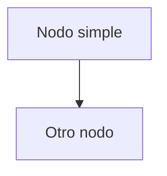
